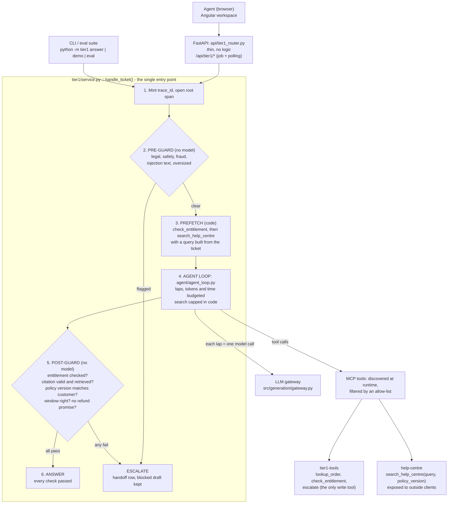

# Billing Support: Tier-1 Deflection Assistant (technical README)

This is the technical README: setup, configuration, architecture, code map, data stores, APIs, MCP servers,
evaluation, testing and deployment. What the app does for each kind of user, and how to see each feature in the
browser, is in the functional README, [FUNCTIONAL_README.md](FUNCTIONAL_README.md) (also in the app under **Help**).

**All data in this project is synthetic.** Customers, orders, tickets and the help-centre corpus are generated by
`scripts/generate_synthetic_corpus.py`. No real client content is included.

---

## Contents

1. [What the system is](#1-what-the-system-is)
2. [Quick start](#2-quick-start)
3. [Configuration](#3-configuration)
4. [Architecture](#4-architecture)
5. [Code map](#5-code-map)
6. [Data stores](#6-data-stores)
7. [API](#7-api)
8. [MCP servers and outside clients](#8-mcp-servers-and-outside-clients)
9. [Model gateway, limits and cost](#9-model-gateway-limits-and-cost)
10. [Observability and privacy](#10-observability-and-privacy)
11. [Evaluation](#11-evaluation)
12. [Tests](#12-tests)
13. [Deployment](#13-deployment)
14. [Results and known limits](#14-results-and-known-limits)
15. [Documentation archive](#15-documentation-archive)

---

## 1. What the system is

A support assistant for billing and Tier-1 customer tickets, built up over Weeks 4 to 12:

- **Tier-1 Deflection Assistant (the Week 12 capstone, the main product).** It answers a Tier-1 ticket from the help
  centre with a citation that names the refund-policy version it used, checks the customer's real entitlement through
  a tool before saying anything about refunds or shipping, and escalates to a person instead of guessing.
- **Docs mode.** Retrieval-augmented answers over the help centre, with citations and a refusal when the corpus has
  no answer (Weeks 4 to 6, observability added in Week 11).
- **Automatic routing in the chat.** Customers do not pick a mode. A front desk (`POST /api/chat/route`) sends each
  question to the assistant or to Docs mode; only admins can force a mode, for testing.
- **Earlier agent experiments**, kept and reachable from the Admin page: the Week 7 ReAct agent, Week 8 prompt
  injection tests, Week 9 MCP billing tools, Week 10 single agent against a workflow and multi-agent (A2A) runs.
- **Billing and accounts:** sign-up, plans, add-ons, subscriptions and invoices.
- **Catalog:** every list, setting, price, prompt, guard rule and evaluation case is stored in a database and edited
  by admins on the **Data** page. None of it is hard-coded.

One entry point, `tier1.service.handle_ticket`, serves the Angular workspace, the CLI and the evaluation suite, so the
evaluation grades exactly what an agent sees.

**Tech stack**

| Layer | Technology |
|---|---|
| UI | Angular 19 (standalone components, signals, OnPush) |
| API | FastAPI and Uvicorn, slowapi rate limits |
| Auth | Email and password, or Google OAuth; JWT sessions (7 days) |
| Models | Groq: agent `openai/gpt-oss-120b`, judge `qwen/qwen3.8-27b` (a different family, to avoid self-grading); Ollama optional for Docs mode |
| Embeddings | `BAAI/bge-base-en-v1.5` via sentence-transformers |
| Retrieval | Local ChromaDB vector store (on disk, `chroma_db/`, cosine distance), BM25, Reciprocal Rank Fusion (k = 60) |
| Tool protocol | Model Context Protocol (MCP) over stdio, and streamable HTTP for the help-centre server |
| Databases | SQLite: `data/app.db`, `data/tier1.db`, `data/catalog.db` |
| Tracing | Own span store (SQLite) and Langfuse (optional) |

---

## 2. Quick start

You need Python 3.12, Node 22 (for the web app) and a free Groq API key.

```bash
python -m venv .venv
```

```bash
source .venv/bin/activate
```

On Windows, activate with `.venv\Scripts\activate`.

```bash
make up
```

On Windows without make use `./tasks.ps1 up`; without either, `python -m tier1 up`.

The first run creates `.env` from `.env.example` and stops with the list of values to fill in (`GROQ_API_KEY`,
`JWT_SECRET` of 32 or more characters, `ADMIN_EMAIL`). Run it again. It checks the key and the models it can reach,
installs packages, generates the synthetic data, builds the search index, loads the ticket database, creates the
catalog from `data/seed/`, and answers one random ticket. Every stage prints OK, SKIP or FAIL with the fix, and a
re-run skips what is done.

Start the web app in two terminals:

```bash
make api
```

```bash
cd frontend && npm ci && npx ng serve --proxy-config proxy.conf.json
```

Open http://localhost:4200. The `ADMIN_EMAIL` account is the team lead (admin); any other account is a customer.
`GET /api/health` is liveness and `GET /api/ready` says whether the app can answer tickets.

**Make targets** (`./tasks.ps1 <target>` on Windows):

| Target | What it does |
|---|---|
| `up` | one command from a fresh clone (above) |
| `setup` | install dependencies |
| `corpus` | generate the synthetic corpus (deterministic) |
| `ingest` | build the Tier-1 vector collection |
| `seed` | load synthetic customers, orders and tickets into `data/tier1.db` |
| `demo` | answer a random ticket (the seed is printed so the draw can be repeated) |
| `answer TICKET=TK3001` | answer one ticket |
| `test` | unit and integration tests |
| `smoke` | talk to both MCP servers as an outside client would |
| `eval` | the integrated evaluation suite (`make eval ARGS="--tag fix1 --resume"`) |
| `mcp-http` | serve the help-centre MCP server over HTTP on :8765 |
| `api` | start the API |

**CLI** (`python -m tier1 ...`):

| Command | What it does |
|---|---|
| `up` | the one-command setup |
| `seed` | load synthetic data into `data/tier1.db` |
| `answer --ticket TK3000` or `--text "..."` | answer one ticket and print decision, tools, citations, cost and trace id |
| `demo` | answer a random ticket |
| `eval --tag NAME` | run the integrated evaluation suite (see section 11) |

**Sharing the app with ngrok.** Run the API and UI as above, then `ngrok http 4200` (or `ngrok http 8080` for the
Docker setup). Only the UI needs a tunnel; the dev server forwards `/api`. Things to know:

- Google sign-in needs the ngrok address under *Authorized JavaScript origins*. A free address changes every run;
  reserve the free static domain and use `ngrok http --url=<domain>.ngrok-free.dev 4200`.
- `frontend/angular.json` allows `.ngrok-free.dev`; add other hosts to `allowedHosts`.
- Anyone who reaches the link and signs in spends your model quota. Put a password in front with an ngrok traffic
  policy file kept outside the repo (`basic-auth` action), and stop the tunnel when done. This policy was written from
  ngrok's documentation and has not been run here.

---

## 3. Configuration

Two places, by design:

- **`.env`** holds secrets and deployment wiring only. Template: `.env.example`.
- **The catalog database** (`data/catalog.db`) holds everything a person reads or tunes: reference lists, settings,
  model prices, prompts, guard rules, evaluation data. It is created from `data/seed/` on first start and edited on the
  admin **Data** page. Seed files are read once: an edit or delete in the app is never undone by a restart. To start
  again from the seed files, stop the app and delete `data/catalog.db`.

**`.env` keys**

| Key | Required | Meaning |
|---|---|---|
| `GROQ_API_KEY` | yes | model provider key |
| `JWT_SECRET` | yes | session signing secret, 32+ random characters |
| `ADMIN_EMAIL` | yes | the account that gets the admin role |
| `GOOGLE_CLIENT_ID` | no | enables Google sign-in (also set in `frontend/src/app/components/login/login.component.ts`) |
| `PASSWORD_AUTH_ENABLED` | no | email and password sign-in (default true) |
| `ALLOWED_ORIGINS` | no | CORS origins (default `http://localhost:4200`) |
| `APP_ENV` | no | `development` (default) or `production`; production refuses to start on unsafe settings |
| `LLM_PROVIDER`, `OLLAMA_BASE_URL` | no | Docs mode can use a local Ollama model |
| `LLM_MODEL`, `JUDGE_MODEL`, `LLM_TPM` | no | override the catalog settings of the same name |
| `LLM_CACHE` | no | `readwrite` (development), `off` (production: no prompts on disk), `replay` (CI: no network) |
| `PII_HASH_SALT` | yes in production | salt for hashed customer and order ids in logs and traces |
| `APP_DB_PATH`, `TIER1_DB_PATH`, `CATALOG_DB_PATH` | no | database locations (defaults under `data/`) |
| `TIER1_AS_OF` | no | override the reference date for "days since purchase" |
| `TIER1_DEMO_CUSTOMER_ID` | demo only | the customer a non-admin acts as when no customer email matches; never in production |
| `TIER1_ABLATE` | tests only | switch defences off for before and after runs; never in production |
| `LANGFUSE_PUBLIC_KEY`, `LANGFUSE_SECRET_KEY`, `LANGFUSE_HOST` | no | Langfuse tracing (blank disables) |
| `ALERT_*` | no | SMTP settings and thresholds for alert emails |
| `OBS_DEMO_TOOLS` | no | shows the "plant a bad answer" drill button; false in production |
| `MCP_HTTP_TOKEN` | for `mcp-http` | bearer token for the help-centre MCP server over HTTP, 16+ characters |

A setting whose environment variable is set uses the environment value; the Data page shows that it is overridden.

---

## 4. Architecture

### 4.1 How one Tier-1 ticket flows



Principle: code decides anything about money, eligibility, policy version or escalation; the model writes prose and
chooses which tool to call. A tool failure, a provider failure and a budget hit all end in ESCALATE, never a guess.
No tool can move money. Budgets, limits, prompts and guard patterns come from the catalog.

**Where the model is called (and nowhere else):** agent loop laps (about 2 per ticket with prefetch), the judge
(evaluation only, one per answered case) and the second-contact evaluation (bonus, two per sampled ticket).

### 4.2 The other parts

| Part | How it works |
|---|---|
| Docs mode | `POST /api/ask`: hybrid retrieval (BM25 and dense, RRF) over three chunkings (structure-aware default, baseline, semantic), a cited answer or the refusal message; prompt from the catalog |
| Chat routing | `POST /api/chat/route` (`src/routing/route.py`), cheapest check first: a code in the question goes to the corpus that documents it; then two regex lists (settings `routing.agent_patterns`, `routing.docs_patterns`); only when both or neither match, one classifier call (prompt `router.classify`, can be switched off with `routing.use_llm`). An assistant question from a user with no linked account goes to Docs with a note. `python evaluation/routing_eval.py [--llm]` measures accuracy on the existing Docs and Tier-1 questions plus `evaluation/routing_cases.jsonl` |
| Week 7 agent | `agent/agent_loop.py` with the billing-tools MCP server (`get_ticket`, `get_order`, `get_customer_tier`, `search_knowledge_base`) on the Week 7 tickets in `data/app.db` |
| Week 8 | prompt-injection tests and mitigations (`agent/injection_test.py`, `agent/mitigations.py`), shown on the Trajectory page |
| Week 9 | MCP servers for billing tools and ticket history (`mcp_servers/`) |
| Week 10 | single agent against a deterministic workflow (`agent/race.py`, `agent/workflow.py`) and a multi-agent run with an A2A agent card (`evaluation/week10_multi_agent.py`, `evaluation/week10_race.py`) |
| Week 11 | traces in Langfuse, per-request cost, alert emails, the support drill, thumbs up and down feedback, failure-to-test runs (`src/observability/`, Observability page) |
| Catalog | `src/catalog/`: reference lists, settings (environment, then stored value, then default), prices, versioned prompts with a test gate, versioned guard rules gated by stored examples, evaluation store, change log. A per-process cache is invalidated through a version counter checked every 2 seconds, so edits reach the API, MCP servers and evaluation within seconds |

---

## 5. Code map

```
api/                      FastAPI app
  main.py                 app, CORS, rate limits, Docs mode /api/ask, uploads, traces
  auth.py, config.py      sign-in, JWT, startup validation
  database.py             data/app.db schema, migrations, first seed
  tier1_router.py         Tier-1 queue, jobs, decisions, feedback, escalations, metrics, labels
  chat_router.py          chat front desk: picks the assistant or Docs mode for a question
  catalog_router.py       /api/catalog (read) and /api/admin/catalog (lists, settings, prices, prompts, guards, changes)
  eval_admin_router.py    eval cases, runs, Week 6 page data
  tier1_admin_router.py   Tier-1 customers, orders, tickets CRUD
  admin_router.py, admin_billing_router.py, account_router.py   users, Week 7 data, billing, accounts
  observability_router.py, feedback_router.py, help_router.py   observability, answer feedback, in-app Help
  agent_router.py, race_router.py, trajectory_router.py, multiagent_router.py   earlier weeks' experiments
  refcheck.py             Pydantic validators that check codes against the catalog
tier1/                    the Tier-1 assistant
  service.py              handle_ticket(), prefetch, progress callback
  guards.py               pre-guard and post-guard (rules from the catalog, Unicode normalised first)
  prompts.py, tools.py    prompts (catalog), lookup_order / check_entitlement / escalate
  db.py, store.py         data/tier1.db and every query behind the API
  customer_text.py        draft to customer text: numbered markers, Sources footer, first-name greeting
  eval_cases.py           a reported failure becomes a regression case
  tracing_store.py, masking.py, flags.py, bootstrap.py, __main__.py
agent/                    ReAct loop, MCP client manager, Week 7 to 10 agents and evaluations
mcp_servers/              tier1_tools, help_centre (stdio and HTTP), billing_tools, ticket_history
src/
  catalog/                catalog database: db, seed, ref, settings, prices, prompts, guards, eval_store
  chunking/, ingestion/   chunkers and loaders (.pdf, .md, .txt, .docx, .xlsx, .xls)
  retrieval/              dense, BM25, hybrid RRF, metadata filters (policy version, macros)
  generation/             gateway, LLM client, prompts, citations, refusal, cost, Langfuse
  observability/          tracing, redaction, alerts, feedback, trace store, eval runner
evaluation/               integrated suite (evaluation/integrated/), Week 6 docs eval, judges
scripts/                  corpus generator, ingestion, cost and 10x, closed loop, trace export, smoke tests
frontend/src/app/         Angular: components/tier1 (workspace), components/data (Data page), shared/, services/
data/seed/                first-run seed for the catalog (lists, settings, prices, prompts, guards, Week 7 data)
tests/                    pytest suite
docs/archive/             earlier documentation and deliverables (section 15)
```

---

## 6. Data stores

| Store | Holds | Notes |
|---|---|---|
| `data/app.db` | users, plans, subscriptions, invoices, Week 7 tickets, orders and customers, ticket histories | tracked; migrated on start |
| `data/tier1.db` | Tier-1 customers, orders, tickets (with evaluation ground truth the API never returns), AI results, decisions, feedback, handoffs, spans, jobs | git-ignored; seeded from the synthetic data |
| `data/catalog.db` | reference lists, settings, model prices, prompts and versions, guard rule sets and examples, eval cases, runs, results and labels, change log | created from `data/seed/` on first start |
| `chroma_db/` | ChromaDB vector collections | rebuilt by `make ingest`; an upload creates the collection if it is missing |
| `.cache/llm/` | model response cache | off in production |

**Synthetic data.** `scripts/generate_synthetic_corpus.py` (seed 1201, frozen as-of date 2026-10-01) writes
`data/variant_a/synthetic/`: 120 help articles (30 topics in 4 variants), 40 support macros, the refund policy in
both forms (retired 14-day and current 30-day), a shipping SLA matrix for 6 regions, a changelog, 60 customers (19 on
the legacy 14-day policy), 300 orders and 300 resolved tickets. Three macros quote the retired 14-day window on
purpose, because that is where the original failure came from. Every record is tagged `synthetic: true`, and the
folder carries a `SYNTHETIC.txt` marker. `scripts/ingest_variant_a.py` builds the index (164 documents, 951 chunks).

Docs mode reads the six billing articles in `data/billing_articles/` (with Markdown copies in `data/markdown/`). A
file uploaded on the Admin page is added to that index. If the collection does not exist yet (no `make ingest` run),
the upload creates it, so it then holds only the uploaded files until you rebuild. A file with no extractable text
(for example a scanned, image-only PDF; there is no OCR) is rejected with that reason. Other ingestion errors return
`422 Failed to process document` and the full traceback is written to the server log.

---

## 7. API

Interactive documentation: `http://localhost:8000/api/docs` (turned off when `APP_ENV=production`). Every admin
route returns 403 for other users.

- **Sessions:** a JWT signed with `JWT_SECRET` (HS256, PyJWT) with `iss`/`aud` claims. The users table decides role
  and status on every request, and a token whose user row was deleted is refused.
- **Rate limits:** per client address, from `X-Forwarded-For` set by nginx (uvicorn runs with `--proxy-headers`),
  and per signed-in user on the endpoints that spend model quota (`/api/tier1/answer`, feedback, admin runs and
  replays). Five wrong passwords lock that email for 15 minutes.
- **What a customer sees of a job:** `GET /api/tier1/jobs/{id}` returns the customer-facing result and progress-only
  steps (`type`, `tool`, `stage`, `blocked`); tool arguments and results, model output, tokens, cost and guard codes
  are for admins only. A customer can report only answers from their own jobs.
- **Errors:** every response carries `X-Request-ID`; an unhandled error returns `{detail, request_id}` and is logged
  with the same id. Logs are JSON lines in production (`LOG_FORMAT=json|text` overrides).
- **Readiness:** in production `GET /api/ready` returns only `{status}` unless an admin token is sent.

| Prefix | Who | Purpose |
|---|---|---|
| `/api/auth` | public | config, sign-up, sign-in, Google sign-in |
| `/api/ask`, `/api/upload` | user, admin (upload) | Docs mode answers; document upload |
| `/api/chat/route` | any signed-in user | which mode answers a chat question (30 per minute) |
| `/api/tier1` | user (own jobs), admin | tickets, `POST /answer` plus `GET /jobs/{id}` (at most 2 runs at once), decisions, feedback and the regression loop, escalations, articles, metrics, traces, eval runs, labels, rules |
| `/api/catalog` | any signed-in user | reference lists and public settings for the UI |
| `/api/admin/catalog` | admin | lists, settings, prices, prompts, guards, change log |
| `/api/admin/eval` | admin | eval cases, runs, Week 6 data |
| `/api/admin/tier1` | admin | Tier-1 customers, orders, tickets |
| `/api/admin`, `/api/account` | admin, user | users, Week 7 data, documents, billing; the signed-in user's account |
| `/api/obs`, `/api/feedback` | admin, user | traces, cost, 10x, alerts, drills, eval runs; answer feedback |
| `/api/agent`, `/api/race`, `/api/trajectory`, `/api/multiagent`, `/api/traces` | admin | earlier weeks' experiments (they spend model quota) |
| `/api/help` | any signed-in user | the functional README, filtered by role |
| `/api/health`, `/api/ready` | public | liveness; readiness (the list of problems and fixes only outside production, or to an admin) |

---

## 8. MCP servers and outside clients

| Server | Tools | Used by |
|---|---|---|
| `tier1_tools_server.py` | `lookup_order`, `check_entitlement`, `escalate` | Tier-1 assistant |
| `help_centre_server.py` | `search_help_centre(query, policy_version?, top_k?, include_macros?)` | Tier-1 assistant and outside clients |
| `billing_tools_server.py` | `get_ticket`, `get_order`, `get_customer_tier`, `search_knowledge_base` | Week 7 to 10 agents |
| `ticket_history_server.py` | `lookup_ticket_history`, `get_escalation_history` | Week 9 and 10 |

Servers are listed in `mcp_config.tier1.json` and `mcp_config.json` with a per-server tool allow-list. Tools are
discovered at connect time. The client injects hidden `trace_id` and `parent_span_id` arguments (removed from the
schema the model sees), so one trace id crosses every hop.

**Calling the help-centre server from your own client** (for a reviewer from another squad):

- **Over HTTP:** the author runs `make mcp-http` (needs `MCP_HTTP_TOKEN`; without it the server refuses to start). It
  loads the embedding model (about 10 seconds) and serves `http://127.0.0.1:8765/mcp`. Every request needs
  `Authorization: Bearer <token>`. Use `--host 0.0.0.0` for another machine on the network, or `ngrok http 8765`
  for the internet.
  - MCP Inspector: `npx @modelcontextprotocol/inspector`, transport Streamable HTTP, the URL and the bearer token.
  - Claude Code: `claude mcp add --transport http help-centre http://127.0.0.1:8765/mcp --header "Authorization: Bearer <token>"`.
  - Python: see `tests/test_mcp_http.py`, which connects with the MCP SDK's `streamablehttp_client`, lists the tools
    and calls `search_help_centre`.
- **Over stdio:** clone, install, run `python scripts/generate_synthetic_corpus.py` and
  `python scripts/ingest_variant_a.py`, check with `python scripts/mcp_smoke.py`, then add to your client:
  `{"mcpServers": {"help-centre": {"command": "python", "args": ["mcp_servers/help_centre_server.py"], "cwd": "/path/to/repo"}}}`.
  Raise the client's startup timeout if it gives up during the first 10 seconds.

`search_help_centre` arguments: `query` (put error codes in exactly, for example `ERR-4032`), `policy_version`
(`refund-14d` or `refund-30d`; the other policy is then never returned; an unknown value returns
`invalid_policy_version` with the allowed list), `top_k` (1 to 5, default 3), `include_macros` (internal templates are
hidden by default). Results carry `chunk_id`, `slug`, `policy_version`, `doc_type`, `last_updated`, `section`, `score`
and a snippet; an empty result carries a note telling the caller not to answer from memory.

---

## 9. Model gateway, limits and cost

`src/generation/gateway.py` is the one door to the provider: a disk cache keyed by the full request, a sliding-window
tokens-per-minute limiter (requests wait instead of being refused), retries with backoff for 429 and 5xx, and a
`RateLimited` error that fails at once on a daily or long cap. The assistant then escalates with reason
`rate_limited`, and an evaluation run stops and saves its progress.

Free-tier limits measured for `openai/gpt-oss-120b`: 8,000 tokens a minute, 1,000 requests a day and 200,000 tokens a
day. The daily token limit is in no response header; it shows up as a 429. It caps the system at about 60 tickets a
day, below the 67 a day of today's volume, and it breaks first at 10x. Money is not the constraint.

Cost is computed from token counts and the **Model prices** table in the catalog (checked against Groq's model page
on 2026-10-18). Cost per deflected ticket on run `fix1`: $0.000915. Report: `python scripts/cost_and_10x.py`.

---

## 10. Observability and privacy

- `src/observability/tracing.py` writes spans (start, duration, tokens, cost, status) for every model call, tool
  call and guard; MCP servers write their own spans under the same trace id. `GET /api/tier1/traces/{id}` and the
  trace page show the waterfall. `scripts/export_trace.py <trace_id>` exports one as JSON.
- Every span carries a cost: model calls carry their own, every other span (guards, tool calls, MCP server spans,
  retrieval) records 0.0, and a model call that failed before usage came back stays empty (unknown). The exported tree
  adds `cost_usd_total` per span, its own cost plus everything under it, so the root's total is the ticket's cost.
- Langfuse (optional) receives traces through one wrapped client.
- `src/observability/redact.py` redacts personal data at every sink (spans, Langfuse, alert emails, handoffs, the MCP
  wire log) in three layers: field names, patterns (email, address, phone, Luhn-checked card, SSN-like) and exact
  values from the customer table. Customer and order ids become salted hashes. Free text is never stored in spans.
- Alert emails for costly, slow or failed requests, rate-limited per type; thumbs-down feedback can email the admin.

---

## 11. Evaluation

### 11.1 Integrated suite (Tier-1)

Grades the whole system through `handle_ticket`, not the parts.

```bash
python -m tier1 eval --tag fix1
```

| Flag | Effect |
|---|---|
| `--resume` | continue a run the daily cap stopped (same flags) |
| `--rescore TAG` | recompute summary, agreement and report from stored rows, no model calls |
| `--rejudge TAG` | re-run the two Week 6 judges on a stored run's replies, then rescore; the agent is not called and labels stay valid |
| `--cases regression`, `--case-id REG01` | only cases created from reported failures |
| `--only SLICE`, `--limit N`, `--no-judge` | subsets and cheaper runs |
| `--ablate version_filter,policy_guard,macro_filter,error_code_prompt,prefetch` | switch defences off for before and after numbers |

Cases live in the catalog (Data page, Eval cases). The main suite has 39: 20 drawn at random (seed 1212) from all
300 tickets, 6 for both refund policies (the same question from a 14-day and a 30-day customer), 3 shipping regions,
4 must-escalate (legal, chargeback, safety, fraud), 2 not Tier-1, 2 prompt injections, 2 missing orders. A held-out
suite has 15 tickets the fixes were not derived from. `python evaluation/integrated/build_cases.py --replace`
rebuilds them deterministically.

**Order of evaluation**

1. **Assertions** (`evaluation/integrated/assertions.py`): decision, escalation reason, handoff row, tools called,
   citation valid, policy version named and correct, window and eligibility right, shipping days right, no refund
   promise, no personal data. A case passes only if all pass.
2. **Judges** (`judge.py`), only on answered replies, all on `qwen/qwen3.8-27b`:
   - **primary:** the Week 6 v1 rubric (prompt `judge.week6_v1` with the account facts added, rubric id `week6-v1r`);
     the setting `eval.judge_primary_prompt` chooses it;
   - **second opinion:** the other Week 6 rubric (`judge.week6_v2`, `week6-v2r`), stored as `judge_week6_alt`;
   - **second opinion:** the integrated rubric (`v3b-integrated`), stored as `judge_alt`.
3. **Agreement with people:** a judge is trusted only after it agrees with human labels on at least 85% of at least
   20 replies (both thresholds are settings).

Each run stores its rows in the catalog and writes `results_<tag>.jsonl`, `summary_<tag>.json`, `report_<tag>.md`
and `label_sheet.md` to `docs/archive/deliverables/week12/eval/`. The report includes per-slice and per-check pass
rates, the trajectory section (tool-choice accuracy for the model's own choices and combined, and the
outcome-versus-trajectory gap), cost per deflected ticket, a failure-mode tally with trace ids, and what the suite
does not cover.

**Labelling** is done by a person on the **Label replies** page. The judge's verdict and the assertion results are
hidden; each label stores a hash of the reply, so it never grades a different reply from a later run. Until 20 labels
exist the report says NOT MEASURED.

**Why v1 is the primary judge.** The stored Week 6 rows give 24/25 (96%) for judge prompt v1 and 20/25 (80%) for
prompt v2, so v1 is the Week 6 judge that cleared the 85% target. (Earlier documents quoted 24/25 for v2; that was
wrong.) The original Week 6 model (`llama-3.1-8b-instant`) is no longer available on the key, so neither figure
carries over: agreement must be measured again on integrated replies, and only that number may be quoted.

**Second contact (bonus):** `python -m evaluation.integrated.second_contact` simulates a follow-up and scores whether
the reply pre-empted it, with a human-reply control.

### 11.2 Docs mode and earlier evaluations

- Docs eval set (Week 6, suite `docs`): deterministic assertions plus an LLM judge; shown on Admin, Eval, and run from
  Observability, Failure to test. CLI: `python evaluation/run_eval.py`.
- Week 7 trajectory evaluation and Week 8 injection tests: the Trajectory page.
- Week 10 race and multi-agent: `python -m evaluation.week10_race`, `python -m evaluation.week10_multi_agent`.

---

## 12. Tests

```bash
python -m pytest tests -q --deselect tests/test_structure_chunker.py
```

```bash
cd frontend && npx ng test --watch=false --browsers=ChromeHeadless
```

271 backend tests and 31 frontend specs pass. The three tests in `tests/test_structure_chunker.py` also fail on the
committed code: they expect Markdown articles in `data/billing_articles/`, which holds PDFs. CI deselects them.

What the tests cover: guards (including Unicode and padded-bracket cases), the gateway (cache, replay, retries,
daily-cap fail-fast), redaction, the API (permissions, masking, the feedback-to-case loop), catalog CRUD and its
protections, the evaluation arithmetic, resume and rescore, labels, the Help page, the MCP HTTP server, and two
integration tests that start the real MCP servers with a scripted model and check one trace id across every hop and
that no seeded personal data reaches any sink. Frontend specs fill the reference lists from the seed files, so they
check the labels a fresh install shows.

---

## 13. Deployment

- **Docker:** `docker compose up --build`, then http://localhost:8080. The API runs with `APP_ENV=production` and
  `LLM_CACHE=off` as a non-root user, keeps `app.db`, `tier1.db` and `catalog.db` on the `app-data` volume, and is
  health-checked on `/api/ready`. nginx (`frontend/nginx.conf`) serves the UI, forwards `/api` with the client
  address, compresses responses, caches hashed bundles for a year, never caches `index.html`, and sends a CSP and
  the usual security headers. The images have not been built on the development machine (no Docker daemon).
- **Dependencies:** `requirements.txt` is what the API image installs; `requirements-dev.txt` adds pytest, coverage,
  ruff and pip-audit.
- **Production mode** refuses to start, naming each fix, on example secrets, a short `JWT_SECRET`, `LLM_CACHE` not
  off, or `TIER1_DEMO_CUSTOMER_ID` set.
- **CI** (`.github/workflows/ci.yml`): CPU-only torch, ruff (errors only), `pip-audit`, unit tests with coverage,
  integration tests, `npm audit`, Angular unit tests and the production build. It has not run on a CI runner yet.
- Kept on purpose for a demo-grade build: SQLite, no job queue, no HTTPS proxy.

---

## 14. Results and known limits

### 14.1 Week 12 brief: status by requirement

Status as of 2026-10-19. "Needs a person" items cannot be finished by the code; the functional README lists them in
the order to do them.

| # | Requirement | Status | Evidence | Command |
|---|---|---|---|---|
| 1 | RAG behind one entry point, clickable citations that name the refund-policy version | Met | `src/generation/citations.py` (`[slug @ version]`), source buttons with a policy badge in the workspace; `names_policy_version` 11/11 in `report_fix1.md` | `make answer TICKET=TK3001` |
| 2 | Week 7 agent loop on the integrated retriever; order lookup, entitlement and escalate tools; MCP tools discovered at runtime | Met | `tier1/service.py` runs `agent/agent_loop.py`; tools come from `list_tools()` (`agent/mcp_client.py`), filtered by `mcp_config.tier1.json`. With prefetch on, code makes the entitlement check and first search before the model starts (run `traj_off` shows the model making every call itself) | `make smoke` |
| 3 | Own MCP server called live by another squad's client | Needs a person | Server `mcp_servers/help_centre_server.py` (stdio and HTTP with a bearer token), section 8; `fresh_eyes.md` is still a blank template | `make mcp-http` |
| 4 | Eval suite on the integrated system in one command, 25 to 40 cases, assertions before judges, validated judge re-checked, agreement at least 85% | Partly: agreement needs a person | 39 cases; assertions then judges (`run.py`); primary judge is the Week 6 v1 rubric (96% in Week 6), re-graded on `fix1`. Agreement on integrated replies: NOT MEASURED until 20 labels exist. Pass rates are one draw (an uncached rerun of 10 cases passed 4 against 7) | `python -m tier1 eval --tag fix1`, then `--rescore fix1` |
| 5 | Taxonomy re-scored: 4 to 7 modes, frequency, severity, one trace id each, one new mode from integration | Met | `docs/archive/deliverables/week12/taxonomy.md` (5 modes; mode 4 created by integration). Mode 3 rests on the judge, which is not yet validated | `python scripts/taxonomy_tally.py after fix1` |
| 6 | Trajectory eval on 10+ cases: tool-choice accuracy and the outcome-vs-trajectory gap | Met | `report_fix1.md` "Trajectory" (n = 27 and 30) and `report_traj_off.md` (prefetch off, the model makes every call: n = 16, tool choice 94%, outcome 75%, gap -18.8 points) | `python -m tier1 eval --tag traj_off --limit 20 --ablate prefetch --no-judge` |
| 7 | One trace id through the agent and MCP hops, cost and latency per span, no customer email or address in logs | Met | `trace.json`, `trace_escalate.json`: one id, `server:*` spans from both MCP servers, a cost on every span; checked against every customer email and address | `python scripts/export_trace.py <id>` |
| 8 | Closed failure-to-test loop shown live; cost per deflected ticket; 10x plan with the number | Met in files; the live showing needs a person | `closed_loop.md` (section 7: RAN14 did not go red again in two rehearsals, so the demo shows the loop on RAN02, which is still red; `demo_script.md` Part 3), `cost_and_10x.md` ($0.000915 per deflected ticket; the 200,000-tokens-a-day cap breaks first, 47.6x over in Black Friday week) | `demo_script.md` Part 3 |
| - | One repo a stranger can clone and run | Needs a person | `make up`; not yet tried by someone else, and the latest work must be committed and pushed first | `make up` |
| - | Seam list, architecture, eval report with non-coverage, weaknesses, demo script | Met; weaknesses must be adopted; demo must be delivered | `docs/archive/deliverables/week12/` (`seams.md` has been edited since it was written, as its header says) | - |

### 14.2 Results

- **Integrated eval (`fix1`, production model):** 36 of 39 pass. All refund-policy pair cases pass. This is one
  draw: an uncached rerun of the first 10 cases (`latency10`) passed 4 of 10 where `fix1` passed 7 (RAN05, RAN07 and
  RAN09 flipped). Variance is not measured; a full rerun with the cache off (`fix2`) is next.
- **Judges:** `fix1` was re-graded with the Week 6 v1 rubric as primary (`--rejudge`); v1 and v2 gave the same verdict
  on all 24 answered replies (18 GOOD, 6 NOT GOOD). The integrated rubric said GOOD to 21.
- **Trajectory with the model choosing every tool** (`traj_off`, prefetch off, cache off, 20 cases): tool choice right
  on 15 of 16 model tickets (94%), outcome right on 12 (75%), gap -18.8 points; 6,115 tokens per model ticket.
- **Latency, uncached** (`latency10`): p50 57.1 s and p95 120.1 s back to back. Tickets that did not queue took about
  3 s; the slow ones spent 52 to 111 s waiting for the 8,000-tokens-a-minute limit (the `queue_wait_s` in each trace).
  The cached `fix1` figures (p50 6.2 s) are not representative.
- **Wrong refund policy:** with the version filter and policy guard off, 0 of 10 refund answers cited the wrong
  policy, the same as with them on. Only retrieval exposure moved (78% to 0% of top-3 results containing the wrong
  version, n = 60). The guard is insurance this sample cannot prove is needed.
- **Closed loop:** wrong-source citations went from 6 to 3 of 25 on the same cases on the production model; the
  held-out A/B on a second model (6 against 8 of 15, 4 better, 2 worse) is inconclusive. In two cache-off rehearsals
  RAN14 passed with the two fixes off as well, so it is not shown as a live red-to-green; the demo shows the loop on
  RAN02, which is still red.
- **Token cut (prefetch):** 25% fewer tokens per ticket (4,912 against 6,590) on 10 tickets; 7 against 8 of 10 passed,
  so equal quality is not shown.
- **Integration-created failure mode:** model output contains invisible and lookalike characters in 24 of 39 replies;
  they broke exact-match checks until text was normalised.
- **Not measured yet:** judge agreement with people (needs 20 labels).
- **Open work:** the full uncached rerun (`fix2`) and a second run to measure variance; the fresh-eyes review by
  another squad; the live demo; building Docker and running CI; a paid tier or second provider for capacity; retrieval quality; stronger
  redaction; multi-turn and real data; undo after approve; end-to-end browser tests; a form editor for eval cases.
  The functional README lists them in plain words.

---

## 15. Documentation archive

Everything else that used to be a separate document is kept, unchanged, in [`docs/archive/`](docs/archive/):

| Folder or file | What it is |
|---|---|
| `deliverables/week12/` | capstone evidence: architecture, diagrams, seam list (every problem hit, with a status), taxonomy, weaknesses, cost and 10x, closed loop, demo script, fresh-eyes template, the exported traces and every eval report with its data (tags in its README, including `traj_off`, `latency10` and the `live_*` rehearsals). Scripts and evaluation runs keep writing here |
| `deliverables/week10/`, `deliverables/week11/`, `deliverables/*.md` | earlier weeks' deliverables. The Multi-Agent page reads `deliverables/week10/` |
| `WEEK10_*`, `WEEK11_*`, `WEEK12_*` | implementation notes, concepts and the Week 12 plan |
| `docs/` | Week 4 to 9 notes, MCP guides, demo steps, agent concepts, the previous user and testing guides |
| `agent/` | Week 10 race explanation (rewritten by `agent/race.py`) and demo notes |
| `evaluation/` | Week 5 and 6 results and open coding notes |
| `frontend/README.md`, `evaluation/integrated/README.md` | the Angular scaffold readme and the previous evaluation readme |
