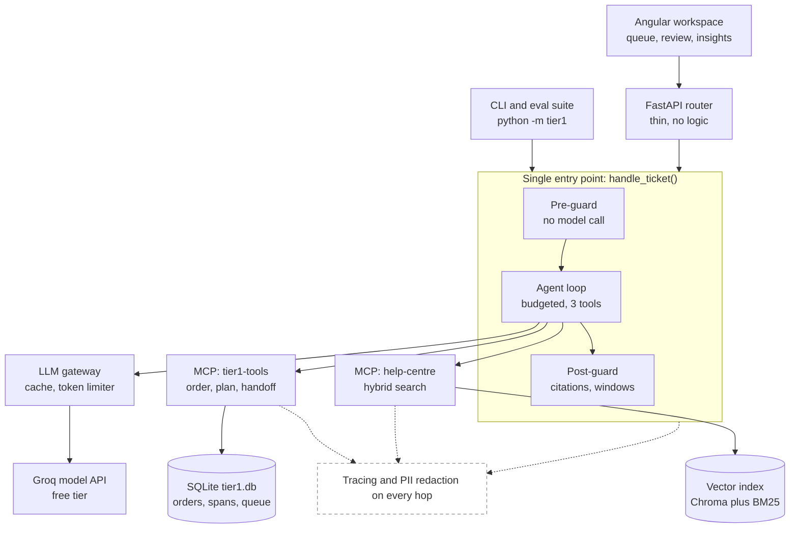
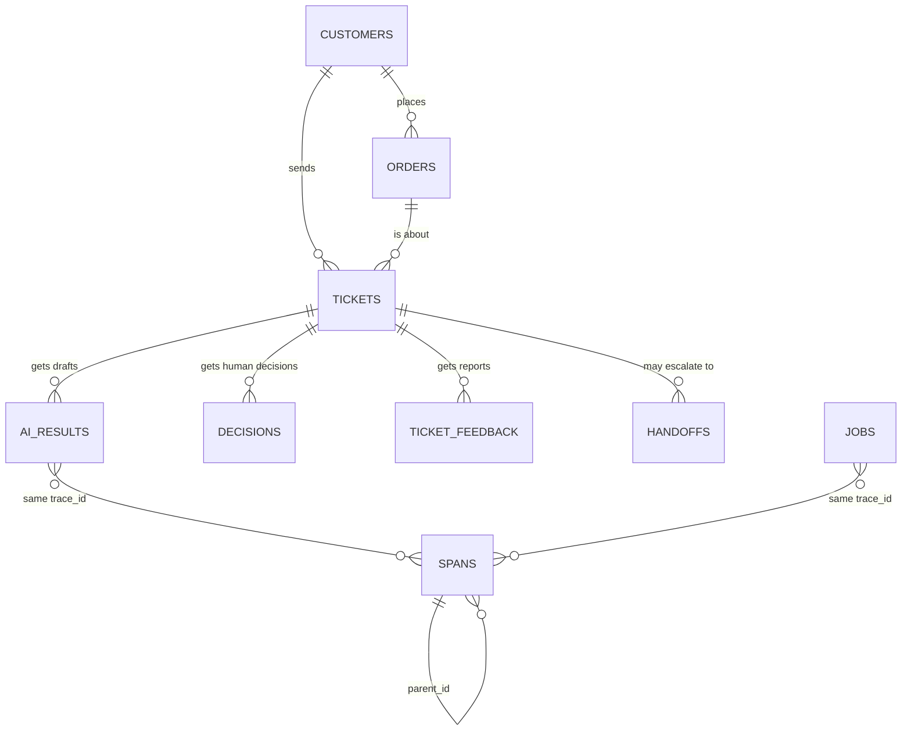

# Diagrams

Both diagrams are checked in as source, so they can be edited and re-rendered. GitHub and VS Code render the Mermaid blocks below.

| File | What it is |
|---|---|
| `architecture.svg` | The architecture diagram as a standalone picture (open it in a browser or paste it into a slide) |
| `architecture.mmd` | The same diagram as Mermaid source |
| `entity_diagram.mmd` | The database entity diagram (all 10 tables in `data/tier1.db`, defined in `tier1/db.py`) |

The entity diagram was checked against the real SQLite schema: every table and column name matches.
Notes: `tickets` carries the eval ground truth (`kind`, `expected_*`, `gold_slug`), which the API never returns to the UI.
`spans.trace_id` joins `ai_results` and `jobs` by value, not by a declared foreign key, because spans are also written by the MCP server processes.
`handoffs.ticket_ref` can also hold a non-ticket reference, so it has no foreign key either.

## Architecture

## Entity diagram

The full column list for each table is in `entity_diagram.mmd`.
